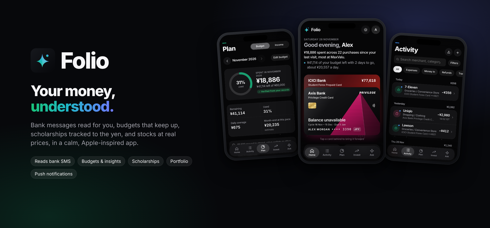
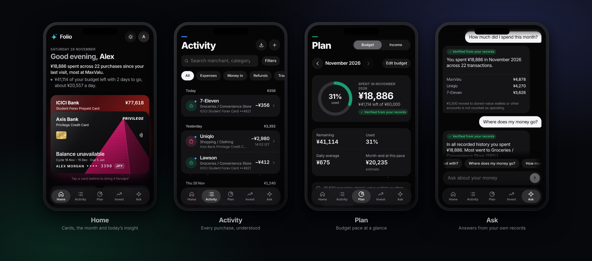
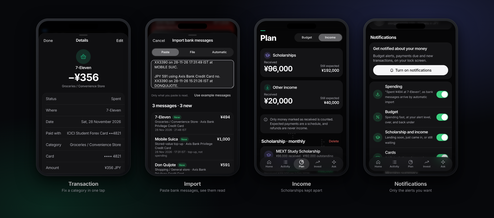
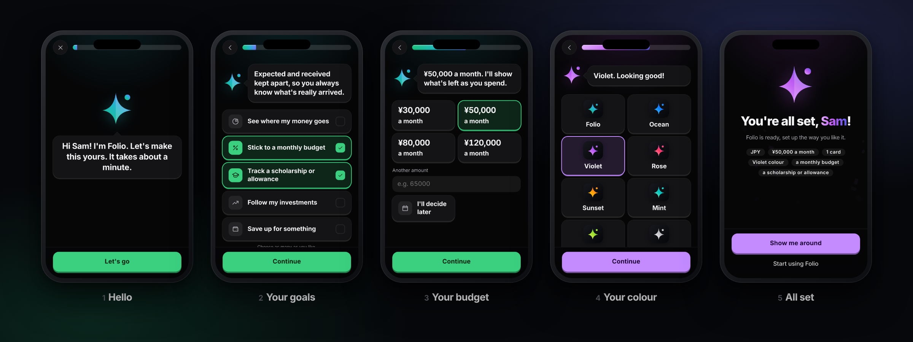
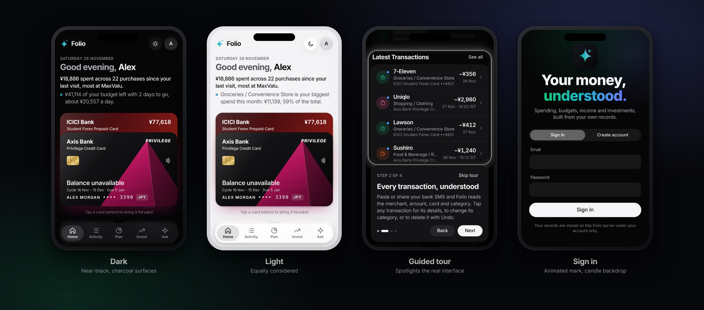
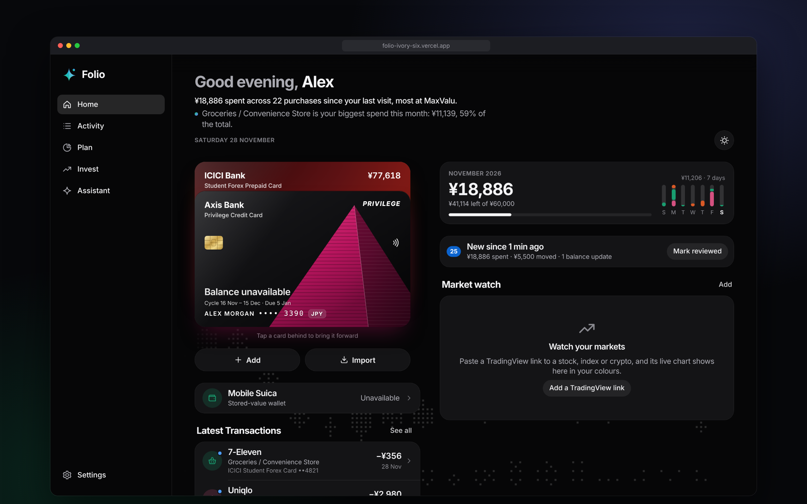
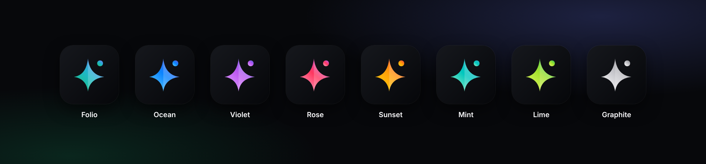
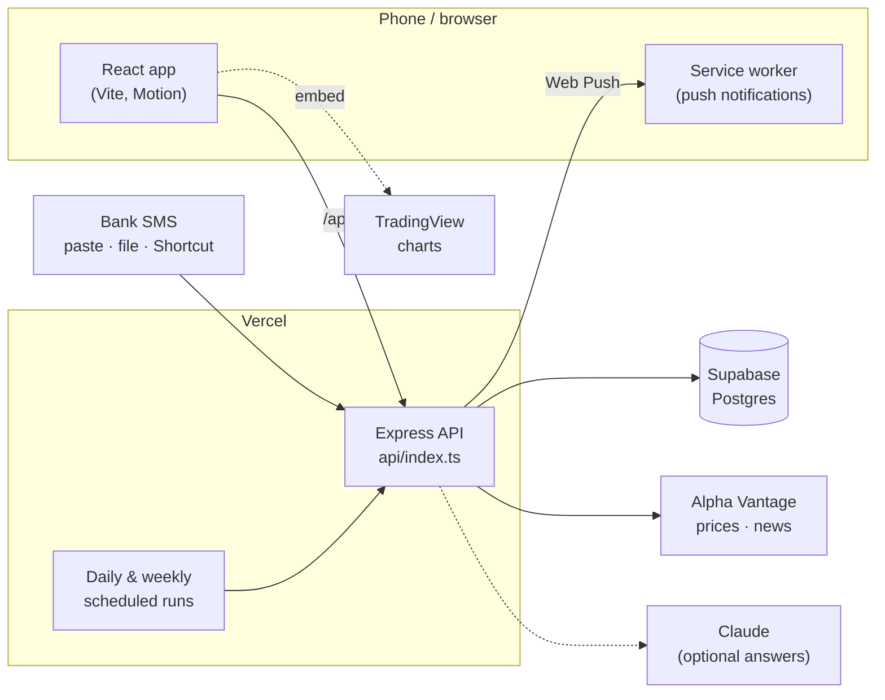

<div align="center">


# Folio

**Your money, understood.**

A calm, Apple-inspired personal finance app. It reads your bank messages, keeps your budget honest,
tracks scholarships to the yen and values your stocks at real prices. Every number on screen comes from your own records.

[**Open Folio**](https://folio-ivory-six.vercel.app)


<br />



</div>

<br />

## About

Folio started as a personal tool: a student in Japan paying with an Indian forex card and a credit card,
living on a monthly scholarship, and holding a few Indian stocks. No single app understood all of that,
and none could read the bank's text messages, so everything was tracked by hand.

Folio brings it into one place. Bank messages become categorised transactions. The budget shows how fast
the month is going, scholarships are tracked as expected and received, and the portfolio is valued at
real market prices. Two things guide every screen:

- **Only real numbers.** Balances come from the bank's own messages or your entries, prices from a market-data
  provider, and anything estimated is labelled as an estimate. Nothing is filled in to look complete.
- **The care of a native app.** The layout, motion and accessibility follow Apple's Human Interface Guidelines,
  so it feels at home on an iPhone while running in any browser.

It is a web app (React and an Express API on Vercel, with Supabase Postgres) that installs to the Home Screen,
sends push notifications and works on phone and desktop.

<br />

## Contents

- [About](#about)
- [Highlights](#highlights)
- [A tour of the app](#a-tour-of-the-app)
- [Design](#design)
- [How it works](#how-it-works)
- [Run it locally](#run-it-locally)
- [Deploy](#deploy-supabase--vercel)
- [Project structure](#project-structure)
- [Testing](#testing)
- [Privacy and honesty](#privacy-and-honesty)

<br />

## Highlights

| | |
|---|---|
| **Reads bank messages** | Paste or forward bank SMS and Folio pulls out the amount, merchant, card, date and balance, even from cut-off or misspelled names like `SEVEN-ELEVE` or `MOBILE SUIC`. |
| **Sorts itself** | About 200 Japanese and Indian merchants are recognised out of the box. Correct one category and Folio remembers it. |
| **Budgets that keep up** | A monthly budget with pace, a projection labelled as an estimate, per-category limits and alerts before you go over. |
| **Scholarships, separately** | Expected payments are a schedule, not money. Only what's actually received is counted, and scholarships never mix with other income. |
| **A real portfolio** | Holdings valued at market prices (Alpha Vantage), daily moves, returns, movers, news and earnings dates, plus your own plan for each stock. |
| **Insights each visit** | Two lines under the greeting: what changed since you last looked, and one insight picked for the goals you chose. |
| **Push notifications** | Budget, scholarship, card-due, spending and weekly recaps, worded like a friend and quiet overnight. They work on iPhone from the Home Screen too. |
| **Ask Folio** | Ask about your money in plain language. Answers are worked out from your records and labelled *Verified*, *Estimate* or *AI-generated*. |
| **Make it yours** | A Duolingo-style setup, eight accent colours that also restyle the app icon, light and dark themes, and your own cards and market watch. |

<br />

## A tour of the app



**Home:** your cards stacked like Wallet (tap the one behind to bring it forward), this month at a glance,
the latest transactions and your own TradingView market watch.
**Activity:** every purchase grouped by day, with search and filters.
**Plan:** budget pace, where the money went and month-by-month trends.
**Ask:** questions answered from your records.



Open any transaction to fix its category in one tap (Folio learns from it). Paste bank messages to see
exactly how each will be read before anything is saved. Keep scholarships apart from other income,
and choose which alerts reach your lock screen.

### First run



New accounts are set up one question at a time, with the Folio mark as a guide that reacts to each answer.
The setup asks for goals, currency, how money comes in, a budget, a colour and your cards. The answers shape the
app: the currency, budget and accent, which cards appear, what the tour covers and which insights come first.

### Light, dark and a guided tour



### On the desktop



### Eight accent colours



Each accent recolours buttons, highlights, the mark's gradient and the chart line, and comes with its own
home-screen icon, so Folio added to an iPhone carries the colour you picked.

> Screenshots use a demo account with sample data.

<br />

## Design

Folio is designed with Apple's Human Interface Guidelines and the motion principles from Apple's
*Designing Fluid Interfaces*:

- **Calm and honest.** The amount is always the most prominent thing. Estimates say so, and nothing is invented.
- **Native feel.** Grouped lists, sheets that rise and follow your finger, action sheets for destructive choices and Undo instead of "are you sure?".
- **Fluid motion.** Springs that can be grabbed mid-flight and keep your swipe's speed, page changes that slide in the direction you're going, and screens that cascade in once.
- **Accessible.** Text contrast of at least 4.5:1, nothing below 11pt and 44pt tap targets. Reduce Motion, Reduce Transparency and Increase Contrast are all supported.
- **Smooth on phones.** Only transform and opacity animate. Expensive blurs pause during motion, and `npm run motion` measures every animation on a throttled iPhone (see [Testing](#testing)).

<details>
<summary><b>Motion details</b></summary>

| Moment | What happens |
|---|---|
| Launch | The logo's stars trade places while data loads, then the screen fades away and Home cascades in |
| Page change | The new page slides in from the side you're heading to, and the tab pill glides across |
| Light and dark | The new theme spreads as a circle from the button you pressed |
| Sheets | Rise on a spring and track your drag 1:1. Letting go keeps your speed and decides by where it would land |
| Cards | Tap the card behind and it springs forward while the others re-stack |
| Numbers | Rise in character by character the first time, then count between values |
| Tour | A spotlight glides between sections, built from compositor-only layers |
| Background | A dithered candlestick chart flows across the lower screen and pauses while anything else moves |

</details>

<br />

## How it works



**Bank messages.** A website can't read SMS, and on iPhone no app can. Folio takes messages in
four ways: paste them, import a file (text, JSON or an Android *SMS Backup & Restore* XML), share them from Android once Folio
is installed, or automatically via a personal endpoint (`POST /api/ingest/sms` with a bearer token) for an
iOS Shortcuts automation or an Android SMS forwarder.

**Parsing.** `shared/sms.ts` classifies each message (transaction, balance, OTP, promo, failed, reminder)
and extracts its fields. `shared/merchants.ts` matches merchants in three steps: exactly, from a cut-off
descriptor, then with a small typo allowance, with guards against look-alikes. Duplicates are caught by message and
by fingerprint, and two identical purchases on one day are told apart by the balance left afterwards.

**Notifications.** Web Push with server-generated signing keys stored encrypted. Every alert has a key so
it's never sent twice, and alerts during a phone's quiet hours wait for the morning run.

<br />

## Run it locally

```bash
npm install
npm run build
npm start            # http://localhost:8787
```

For development with hot reload, use `npm run dev` (web on 5173, API on 8787).

No database setup is needed locally. Without `DATABASE_URL`, Folio uses an embedded Postgres (PGlite) in `data/pglite`.

| Script | What it does |
|---|---|
| `npm run dev` | API and web with hot reload |
| `npm run build` | Production build into `dist/` |
| `npm start` | Serve the built app and API |
| `npm test` | API and parser tests |
| `npm run typecheck` | TypeScript, no emit |
| `npm run motion` | Frame-timing check of every animation (server must be running) |

<br />

## Deploy: Supabase + Vercel

**1. Database (Supabase).** Create a project, then go to **Connect** and copy the **Transaction pooler** string
(port 6543) with your password in it. Folio creates its own tables on first request. Row-level security is on with no
policies, so Supabase's public Data API can't touch them; only the app's own connection can.

**2. App (Vercel).** Import the repository; the build settings come from `vercel.json`. Then add the
environment variables below and deploy.

| Variable | Required | Purpose |
|---|---|---|
| `DATABASE_URL` | Yes | Supabase transaction-pooler connection string |
| `FOLIO_SECRET` | Yes | Long random string (`openssl rand -hex 32`). Encrypts saved keys; keep it stable |
| `DATABASE_CA` | | The database's SSL certificate, to verify the server |
| `CRON_SECRET` | | Protects the scheduled notification runs |

Without the two required variables, the function refuses to start rather than fall back to anything that could lose data.
Market data and AI answers use keys you add in the app's Settings (Alpha Vantage and Anthropic). Without an
Anthropic key, Ask still answers the common questions directly from your records.

<br />

## Project structure

```
api/index.ts              Vercel function (the Express app)
server/
  app.ts                  Routes, security headers, scheduled-run endpoint
  db.ts                   Postgres (Supabase via pg, or PGlite locally) and schema
  auth.ts                 Accounts, sessions, rate limiting
  routes/                 core (transactions, accounts, budgets, push), income, portfolio
  services/
    ingest.ts             Bank messages to transactions, duplicates, learning
    insights.ts           The two lines under Home's greeting
    notify.ts             Push notifications: wording, quiet hours, scheduled runs
    summary.ts            Spending, budgets, income totals
    market.ts             Alpha Vantage, cached and paced
    assistant.ts          Ask Folio
shared/
  sms.ts                  Bank-message parser
  merchants.ts            Merchant dictionary with fuzzy matching
  accents.ts              Accent colours, app icons, manifests
src/
  screens/                Home, Activity, Plan, Invest, Assistant, Settings, Setup, Tour, sheets
  ui/                     Design-system pieces: sheets, springs, motion, charts, cards, logo
  components/             Background animation, TradingView embed, text effects
  styles.css              Design tokens and styles
public/                   Icons per accent, manifests, service worker
tests/                    API, parser and notification tests
scripts/                  Icon generator, motion check
```

<br />

## Testing

```bash
npm test             # 41 tests: parser, merchants, API, budgets, income, notifications
npm run motion       # frame timing on an emulated iPhone at 4× CPU slowdown
```

The motion check runs every animation in the app and reports dropped frames. After the motion pass:

| Interaction | Janky frames |
|---|---|
| Sheets open / close | 0–9% |
| Page changes | 3–10% |
| Scrolling | ~1% |
| Background, idle | 0% |

<br />

## Privacy and honesty

- **Your data stays yours.** Every query is scoped to the signed-in account. Only the last four digits of a card are ever stored, never a full number or CVV.
- **Nothing is invented.** Balances come from bank messages or your own entries. Prices come from a market-data provider or aren't shown. Expected income is never counted as received.
- **Everything is labelled.** Every figure is either verified from your records, marked as an estimate or marked as AI-generated.

<br />

<div align="center">
<sub>Built with care for the details. <a href="https://folio-ivory-six.vercel.app">folio-ivory-six.vercel.app</a></sub>
</div>
